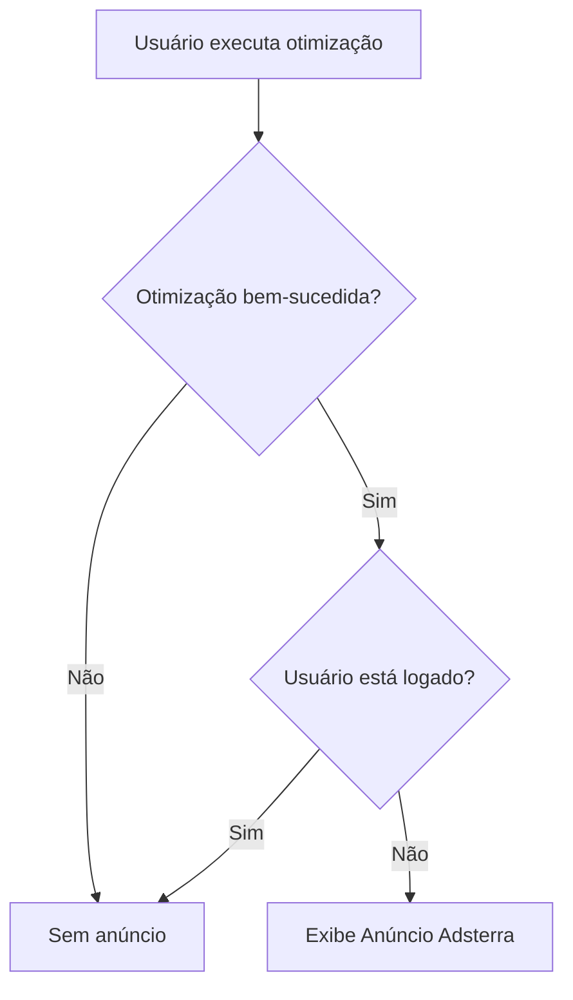

# 💰 Monetização com Adsterra - Documentação

## 📋 Implementação Concluída

Anúncios Adsterra foram implementados no **Qlik Codex I.A** com as seguintes características:

### ✅ Características da Implementação

#### 1. **Público-Alvo**

- ✅ **Apenas usuários não autenticados** (`user === null`)
- ✅ **Apenas após otimização bem-sucedida** (`hasResult === true`)
- ❌ **Nunca** para usuários logados (Premium/Owner)

#### 2. **Posicionamento**

- 📍 Logo **após a seção de resultados** da otimização
- 📍 Antes do footer da página
- 🎨 Design integrado ao tema do Qlik Codex

#### 3. **Formato do Anúncio**

- 📐 **Banner 300x250** (formato padrão do Adsterra)
- 📱 **Responsivo** - adapta em mobile
- 🎨 **Tema claro/escuro** - suporta ambos

## 📁 Arquivos Criados

### 1. Componente Principal

```
web/src/components/AdsterraAd/
├── AdsterraAd.tsx        # Componente React
├── AdsterraAd.css        # Estilos
└── index.ts              # Export
```

### 2. Integração

```
web/src/pages/OptimizerPageV2.tsx
- Import do componente AdsterraAd
- Renderização condicional (linha ~945)
```

## 🔧 Configuração Atual

### Adsterra Settings

```javascript
{
  'key': '1c2eff3d048b99101a6e6be6f41b5fb0',
  'format': 'iframe',
  'height': 250,
  'width': 300
}
```

### Script Source

```
https://www.highperformanceformat.com/1c2eff3d048b99101a6e6be6f41b5fb0/invoke.js
```

## 🎯 Como Funciona

### Fluxo de Exibição



### Lógica de Renderização

```tsx
{
  hasResult && !user && (
    <AdsterraAd
      format="banner"
      title="🎯 Apoie o Qlik Codex I.A - Ferramenta Gratuita"
    />
  );
}
```

## 🧪 Como Testar

### 1. **Teste Local (Dev)**

```bash
cd web
npm run dev
```

### 2. **Cenário de Teste**

1. **Abra** `http://localhost:5173/optimizer` **sem fazer login**
2. **Cole** um script Qlik de teste
3. **Execute** a otimização (modo FREE)
4. **Aguarde** conclusão
5. **Verifique** se o anúncio aparece após os resultados

### 3. **Verificar Condicional**

- ✅ Anúncio **aparece** para usuário não logado
- ❌ Anúncio **NÃO aparece** se fizer login
- ❌ Anúncio **NÃO aparece** antes da otimização concluir

### 4. **Build de Produção**

```bash
cd web
npm run build
# Verificar se compila sem erros
```

## 📊 Tracking e Analytics

### Métricas Disponíveis no Adsterra Dashboard

- Impressões (visualizações do anúncio)
- Cliques
- CTR (Click-Through Rate)
- RPM (Revenue Per Mille)
- Ganhos totais

### Link do Dashboard

🔗 https://beta.publishers.adsterra.com/websites

### Recomendações de Monitoramento

1. **Primeiros 7 dias**: Verificar diariamente
2. **CTR esperado**: 0.5% - 2% (típico para banners)
3. **RPM esperado**: $0.50 - $3.00 (depende do nicho)

## 🎨 Customização

### Alterar Título do Anúncio

```tsx
<AdsterraAd format="banner" title="Seu texto aqui" />
```

### Alterar Posição

Mova o bloco `{hasResult && !user && (...)` para outra localização no JSX.

### Adicionar Mais Formatos

O componente suporta `format="native"` para anúncios nativos (futuro).

## 🚀 Deploy

### Vercel (Recomendado)

```bash
git add .
git commit -m "feat: Add Adsterra monetization for non-logged users"
git push origin main
# Vercel auto-deploy
```

### Checklist Pré-Deploy

- [x] Build local passa sem erros
- [x] Testes manuais concluídos
- [x] Anúncio apenas para não-logados
- [x] Design não intrusivo
- [ ] Testar em produção após deploy

## ⚙️ Configurações Avançadas

### CSP (Content Security Policy)

Se houver problemas de CSP em produção, adicione ao `vercel.json`:

```json
{
  "headers": [
    {
      "source": "/(.*)",
      "headers": [
        {
          "key": "Content-Security-Policy",
          "value": "frame-src 'self' https://www.highperformanceformat.com;"
        }
      ]
    }
  ]
}
```

### Environment Variables

Se quiser tornar a chave configurável:

```bash
# .env.production
VITE_ADSTERRA_KEY=1c2eff3d048b99101a6e6be6f41b5fb0
```

```tsx
// AdsterraAd.tsx
const ADSTERRA_KEY =
  import.meta.env.VITE_ADSTERRA_KEY || "1c2eff3d048b99101a6e6be6f41b5fb0";
```

## 📈 Otimização de Receita

### Dicas para Aumentar RPM

1. **Viewability**: Anúncio está em posição visível ✅
2. **Traffic Quality**: Brasil tem CPM moderado (~$1-2)
3. **Nicho**: BI/Data tem CPM alto (bom para Qlik Codex)
4. **Device Mix**: Desktop geralmente tem CPM maior

### A/B Testing Futuro

- Testar posição: após resultado vs sidebar
- Testar formatos: banner vs native ads
- Testar copy do título

## 🔒 Política de Privacidade

### Atualizar Terms

Adicione à página de termos/privacidade:

> "Utilizamos anúncios de terceiros (Adsterra) para usuários não autenticados.
> Esses anúncios podem coletar dados de navegação para personalização.
> Usuários registrados não visualizam anúncios."

## 🆘 Troubleshooting

### Anúncio não aparece

1. ✅ Verificar `!user` retorna `true` (console.log)
2. ✅ Verificar `hasResult` é `true`
3. ✅ Verificar network requests para `highperformanceformat.com`
4. ⚠️ Pode levar 5-10s para carregar pela primeira vez
5. ⚠️ Ad blockers vão bloquear (esperado)

### Console Errors

```
Refused to load frame...
```

Solução: Adicionar domínio ao CSP (ver acima)

### Anúncio aparece em branco

- Aguardar 30-60s após account approval no Adsterra
- Verificar se site está aprovado no dashboard

## 📝 Notas Adicionais

- **Ad Blocker**: ~25-40% dos usuários têm, o que é normal
- **Mobile**: Anúncio é responsivo, mas RPM pode ser menor
- **Compliance**: Adsterra é GDPR compliant
- **Pagamento**: Threshold geralmente $5-100 (configurável)

---

**Implementado**: 2025-12-20  
**Status**: ✅ Pronto para produção  
**Próxima Review**: Após 1000 impressões
