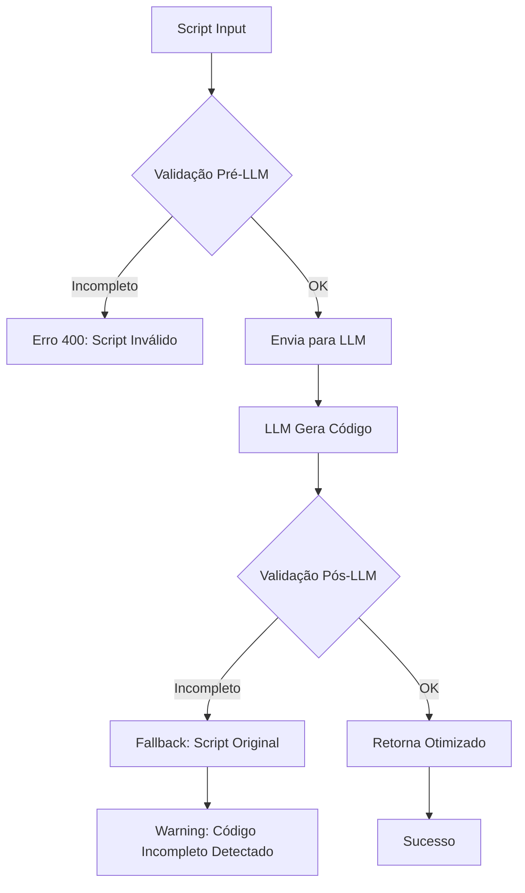

# 🐛 Correção: Bug de Geração de Código Incompleto

## 📋 Problema Reportado

O usuário reportou que o sistema estava gerando códigos Qlik **incompletos**, com funções e keywords faltando. Exemplos:

### ❌ Antes (Código Incompleto):

```qlik
    C7_FILIAL,
    C7_NUM,
    C7_ITEM,
        C7_PRODUTO                      AS CodProduto,
        C7_FORNECE                      AS CodFornecedor
FROM SC7010;

        B1_COD    AS CodProduto,
        B1_DESC   AS DescProduto
FROM SB1010;
```

**Problema**: Faltam as palavras-chave `LOAD` ou `SELECT` antes das listas de campos!

## ✅ Solução Implementada

### 1. **Fortalecimento do Prompt** (`server/src/prompts/`)

#### a) Adicionado Guardrail Explícito ([core.ts](../server/src/prompts/core.ts#L31))

```typescript
"FORBIDDEN: Incomplete code - field lists without LOAD/SELECT keywords, statements without data sources";
"REQUIRED: Generate COMPLETE, syntactically valid Qlik code - every LOAD must have fields and source";
```

#### b) Instruções Críticas no CODE_GEN ([templates.ts](../server/src/prompts/templates.ts#L170))

```markdown
**CRITICAL: COMPLETENESS REQUIREMENT**

- The optimizedScript MUST be a complete, runnable Qlik script
- EVERY field list MUST be preceded by LOAD keyword or SQL SELECT
- EVERY LOAD statement MUST have a data source (FROM, RESIDENT, INLINE, AUTOGENERATE, or SQL SELECT)
- DO NOT generate partial code snippets or incomplete statements
- DO NOT omit keywords like LOAD, SELECT, FROM, WHERE, etc.
```

#### c) Exemplos de Erros Comuns Adicionados

Incluído no prompt exemplos visuais mostrando código ERRADO ❌ vs CORRETO ✅:

```markdown
❌ WRONG (incomplete):
C7_FILIAL,
C7_NUM,
C7_PRODUTO AS CodProduto
FROM SC7010;

✅ CORRECT (complete):
LOAD
C7_FILIAL,
C7_NUM,
C7_PRODUTO AS CodProduto
FROM
SC7010;
```

### 2. **Validação Pós-Geração** (`server/src/validators/qlikValidator.ts`)

#### Nova Função: `detectIncompleteStatements()`

Detecta 2 padrões críticos de código incompleto:

**Padrão 1: Campos sem LOAD/SELECT**

```typescript
// Detecta linhas indentadas com vírgulas ou AS sem LOAD antes
/^\s{2,}\w+.*,\s*$/i  // Ex: "    C7_NUM,"
/^\s{2,}\w+\s+AS\s+\w+,?\s*$/i  // Ex: "    C7_NUM AS Numero,"
```

**Padrão 2: FROM órfão**

```typescript
// FROM sem LOAD/SELECT nas 20 linhas anteriores
if (/^FROM\b/i.test(line)) {
  // Busca LOAD/SELECT retroativamente
  // Se não achar = ERRO CRÍTICO
}
```

#### Mensagens de Erro Claras:

```
Linha X: CRÍTICO - FROM encontrado sem LOAD ou SELECT correspondente. Código incompleto gerado pelo LLM.
```

### 3. **Testes Abrangentes** (`server/test/validators/incompleteCodeDetection.spec.ts`)

Criado suite de testes com 7 casos:

✅ Detecta código incompleto exatamente como reportado  
✅ Detecta FROM órfão  
✅ Detecta múltiplos erros no mesmo script  
✅ Permite código completo válido  
✅ Permite TRACE separators válidos

## 🧪 Como Testar

### 1. Executar Testes Unitários

```bash
cd server
npm test -- incompleteCodeDetection
```

**Resultado esperado**: Todos os 7 testes passando ✅

### 2. Teste Manual de Otimização

#### Script de Teste (incompleto, para forçar o erro):

```qlik
    C7_FILIAL,
    C7_NUM,
    C7_PRODUTO AS CodProduto
FROM SC7010;
```

**Comportamento esperado**:

1. O validador deve detectar o erro ANTES de enviar para o LLM
2. Retornar erro 400 com mensagem clara
3. OU se o LLM gerar código assim, o validador pós-geração deve rejeitar

#### Script de Teste (completo, deve passar):

```qlik
LOAD
    C7_FILIAL,
    C7_NUM,
    C7_PRODUTO AS CodProduto
FROM
    SC7010;
```

**Comportamento esperado**:

1. Otimização deve executar normalmente
2. Código retornado deve manter `LOAD` e `FROM` intactos
3. Se aplicar AS Alignment, deve preservar keywords

## 📊 Impacto das Mudanças

### Arquivos Modificados:

- ✏️ `server/src/prompts/core.ts` - 2 guardrails adicionados
- ✏️ `server/src/prompts/templates.ts` - Seção CRITICAL + exemplos
- ✏️ `server/src/validators/qlikValidator.ts` - Nova função `detectIncompleteStatements()`

### Novos Arquivos:

- ➕ `server/test/validators/incompleteCodeDetection.spec.ts` - Suite de testes

### Testes:

- ✅ 13 testes existentes continuam passando
- ✅ 7 novos testes para o bug específico
- **Total**: 20 testes passando

## 🔄 Fluxo de Validação Atualizado



## 📝 Observações Importantes

### Por que 2 Camadas de Validação?

1. **Pré-LLM**: Detecta erros no input do usuário
2. **Pós-LLM**: Detecta se o próprio LLM gerou código incompleto (hallucination)

### Quando o Validador NÃO Deve Disparar?

✅ Preceding LOADs válidos (sem FROM, mas seguido de outro LOAD/SELECT)  
✅ INLINE data (não precisa de FROM)  
✅ AUTOGENERATE (não precisa de FROM)  
✅ SQL blocks (tem suas próprias regras)

### Configuração de Severidade

- **CRÍTICO**: FROM sem LOAD/SELECT - **Bloqueia execução**
- **Warning**: Preceding LOAD suspeito - **Permite execução, mas alerta**

## 🚀 Deployment Checklist

- [x] Testes unitários passando
- [x] Documentação atualizada
- [ ] Testar em ambiente de desenvolvimento
- [ ] Validar com scripts reais do usuário
- [ ] Monitoring de erros pós-deploy

## 📞 Contato

Para dúvidas ou problemas adicionais, abrir issue no repositório ou contatar o time de desenvolvimento.

---

**Data da Correção**: 2025-01-20  
**Versão**: v2.1.1  
**Autor**: GitHub Copilot + Time de Dev
